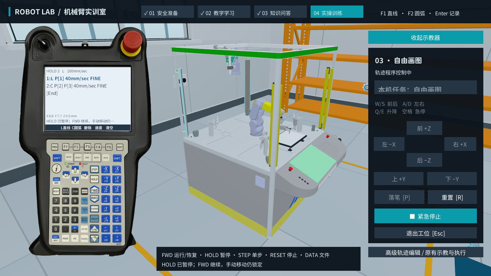
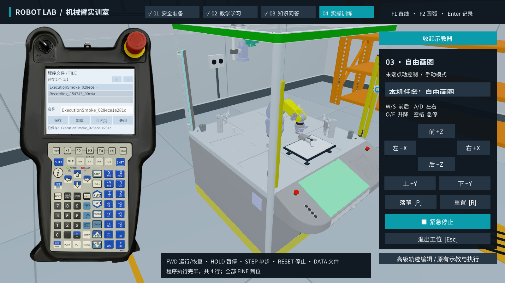

# 控制器编程交付验收（2026-10-24）

主工程：`D:\dachuang-unity`，Unity `2022.3.61f1c1`。启动场景为 `Assets/RoboticsLab/Scenes/RoboticsTrainingRoom.unity`。

本轮已把组员的控制器界面、L/C 示教数据和仿真机械臂运动接通。编好后直接点击控制器上的 **FWD**；HOLD 暂停，STEP 单步执行一整条指令，RESET 停止但保留程序，DATA 保存、加载或追加返回首点的指令。详细示教步骤见[控制器 L/C 使用说明](控制器L-C编程接入.md)。

## 验收结果

| 检查 | 结果 | 原始报告 |
|---|---|---|
| Unity 2022 Windows 构建 | Succeeded，0 错误、0 警告 | `PendantBuildReport.json` |
| 控制器录点与界面回归 | 146 / 146 项通过，进程退出码 0 | `PendantProgrammingSmoke.json` |
| L/C 运动、文件与控制权限 | 194 / 194 项通过，进程退出码 0 | `PendantExecutionSmoke.json` |
| 直线及三点圆弧几何 | 67 / 67 项通过，含 1000 条固定随机种子的空间圆弧 | `PendantGeometryValidation.json` |
| 仅 L/C 的连续慢速演示 | 完整展示至结束，约 221 秒 | `RecordingShowcaseValidation.json` |

Windows 测试运行真实主场景，通过实际 EventSystem 对实体按键位置进行射线检测并触发点击；运动证据来自 IK 提交后的真实工具位置。执行验收中的几何点位通过数据模型建立，实际按键录点与坐标对应另由 146 项录点检查验证。

已验证直线、经过中间点的圆弧、逐行 FINE 到位、整条圆弧单步、途中暂停和恢复、急停解除后明确恢复、保存后加载并重新执行、02/03 工位数据隔离、换工位停止、新旧程序执行互斥，以及实际落笔生成笔迹。未完成/共线的 C 和工作区外路径会被拒绝；02 合法沿线运动可完成，越过钢丝端点的轨迹会停止并报告原因。

实际 TCP 的直线偏差、圆弧半径/中间点/终点误差、套圈位移、采样数量和笔迹顶点数量保存在 `PendantExecutionSmoke.json`，以该次实际运行报告为准。这些是本场景所选路径的仿真观测，不能外推为全部姿态或实体机器人的精度。

## 实际界面

## 交付

- `Deliverables/RobotLab_Windows.zip`：完整解压后双击 `RobotLab.exe`，运行无需安装 Unity。
- `Deliverables/RobotLab_Source.zip`：包含 Assets、Packages、ProjectSettings、说明和验证资料，使用 Unity 2022 打开。
- `Deliverables/PackageManifest.json`：压缩包大小、文件数及 SHA-256。

测试使用显式 `--pendant-smoke` 或 `--pendant-execution-smoke` 参数启动；正常双击演示程序不会跳过安全帽、教学和问答流程。自动测试生成的唯一临时程序文件已由该次测试清理，用户保存的程序不受影响。
